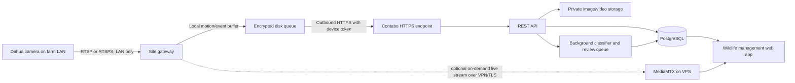

# Build plan: Nepal Wildlife Management System

**Review date:** 22 October 2026

**Deployment target:** Contabo VPS
**First study:** Human–monkey crop-raiding in Pokhara Metropolitan City, Ward 21

## 1. Recommended direction

Build the research application on the Contabo VPS. Keep the first field workflow on personal phones. The VPS can pull a camera stream only when it has a secure route to the camera; DDNS does not bypass CGNAT. The app now supports independently configured camera routes and an authenticated live-stream relay, while router reachability and camera paths still need deployment-time validation. Do not broadly expose camera HTTP/CGI or RTSP services to the public internet. See [Direct camera connection review](CAMERA_DIRECT_CONNECTION.md) for the decision tree and prerequisites.

This directly addresses the image-transfer problem. The camera being visible in DMSS from elsewhere does not mean the VPS can read its stream: DMSS uses the camera vendor's remote-access path, while the proposed research pipeline uses a local camera stream plus an upload initiated from the farm.

## 2. What is in the project today

The provided desktop folder contains a large React 18/Vite application with more than 50 routed screens and reusable UI components. A first self-hosted vertical slice has now been added: Fastify API, PostgreSQL schema, cookie authentication, private media storage, frontend REST adapter, Docker Compose, and a Caddy HTTPS proxy. A camera-side capture agent, object store, background queue, off-site backups, trained wildlife classifier, and SMS/push delivery are still future work.

The existing product ideas worth keeping are:

- **Field and site operations:** sites, field capture, offline capture queue, wildlife observations, sightings, patrols, and geospatial maps.
- **Human–wildlife conflict:** incident and HWC case tracking, affected crops and livestock, damage estimates, response teams, status timelines, and reports.
- **Camera and device operations:** camera registry, RTSP/WebRTC live view, sensors, edge-device inventory, device health, setup wizards, and logs.
- **Evidence and model improvement:** image/video datasets, AI predictions, species catalog, model versions, low-confidence human review, expert review, and community verification votes.
- **Response and communication:** alerts, notification contacts/rules, response protocols/actions, deterrent rules/devices, voice logs, and automation rules.
- **Learning and reporting:** analytics, trends, site comparisons, movement maps, knowledge base, and reports.

The frontend defines **35 data entities** and **7 original server functions**. The self-hosted API provides generic CRUD for those entity names and implements mobile/public capture, human verification queue, camera setup/live-view APIs, and safe placeholders for not-yet-configured AI functions. This API adapter is not data parity: high-level screens still need workflow-by-workflow review and existing records must be explicitly migrated if needed.

### Current camera gap

Camera setup now collects a per-camera network profile, tests the source from the server, encrypts the password with a stable deployment key, and applies an isolated MediaMTX path. Live view uses short-lived, site-authorized tokens and WHEP over HTTPS. Different cameras can use different networks. If a farm is behind CGNAT, direct VPS access still needs a site VPN/tunnel or outbound gateway.

Camera inventory is separate from connection health. A saved profile is not proof of a live stream; server reachability and current stream status are shown separately. Automatic camera events, snapshot upload, wildlife detection, and camera commands are not part of this streaming connector.

## 3. Dahua camera findings and first connection test

The official Dahua product page is for **P3I-PV**, a 3 MP outdoor Wi-Fi pan/tilt camera. The seller/model string **DH-P31-PV** appears to refer to this model family, but confirm the exact label and firmware shown in DMSS/ConfigTool before hard-coding settings. Dahua lists a 2304×1296 main stream, 640×360 substream, H.265 video, Ethernet and 2.4 GHz Wi-Fi, plus microSD support up to 256 GB. The built-in AI claims are human and vehicle detection; they do not establish monkey detection. [Dahua P3I-PV specifications](https://www.dahuasecurity.com/products/wireless-products/outdoor-camera/picoo-series/p3i-pv)

Dahua's outdoor pan/tilt camera manual includes an **RTSP over TLS** setting. This makes direct local streaming a plausible integration route, but the published manual does not give a verified RTSP path for the specific unit/firmware. Confirm the actual port, URL, authentication behavior, codec, and TLS certificate on the camera before building against them. Dahua's generic RTSP guide shows the common `/cam/realmonitor?channel=1&subtype=0` path for other Dahua camera/NVR models; treat that as a diagnostic starting point, not a guaranteed URL for this model. [Official camera manual (PDF)](https://materialfile.dahuasecurity.com/uploads/cpq/83454/user_manual/Wi-Fi_Network_Camera_%28Outdoor_Pan-Tilt%29_User_Manual_V1.0.0.pdf) · [Dahua RTSP setup guide](https://dahuatech.zendesk.com/hc/en-gb/articles/16320900884754-How-to-add-IP-cameras-to-NVR-via-RTSP)

**Bench test before the first field camera trial:** put a Linux laptop on the same LAN as the camera, enable RTSP over TLS if supported, create a dedicated camera user, and use a local RTSP client such as VLC/FFmpeg to read the stream. Keep credentials out of screenshots, shell history, logs, and chat. If TLS or RTSP is not exposed by this firmware, ask the Dahua distributor to confirm third-party access; do not try to scrape the DMSS cloud session. Confirm the exact path and codec before entering it into the app.

## 4. Target architecture

The current deployment uses a TypeScript/Node API, PostgreSQL, private media volume, MediaMTX, and Caddy for HTTPS. MediaMTX bridges configured RTSP/RTSPS or HLS sources to browser WebRTC/WHEP for live viewing; the control API is on an internal Docker network. This live-view path does not yet ingest event snapshots into the research evidence store. [RTSP source documentation](https://mediamtx.org/docs/static-sources/rtsp) · [WebRTC/WHEP playback](https://mediamtx.org/docs/read/webrtc)

### Service responsibilities

| Component | Responsibility |
|---|---|
| React/Vite web app | Camera status, capture timeline, human verification, HWC case entry, research dashboards. |
| REST API | Login/roles, camera and site records, upload authentication, metadata validation, event status, audit trail. |
| PostgreSQL | Users/roles, sites/plots/crops, cameras/gateways, capture events, media metadata, detections, conflict events, interventions, review labels. |
| Private object store | Original images/clips and derived thumbnails; private by default, served through short-lived authorized URLs. |
| Background worker/queue | Image validation, thumbnailing, optional classification, duplicate checks, retries, alert creation. |
| Site gateway | Read the camera on the LAN, create event media, queue it to disk, upload and retry when the internet returns, report health. |
| MediaMTX | On-demand live preview through short-lived, site-authorized WebRTC/WHEP sessions. Never expose the farm camera itself. |

On one VPS, Caddy is the only public web entry point. Keep PostgreSQL, object storage, Redis/queue, API internals, and media-management endpoints private. Add an off-VPS encrypted backup and test a restore; one VPS is a pilot deployment, not high availability.

## 5. Image-ingest workflow for the mobile-first pilot

1. **Use mobile capture first.** The current app queues personal-phone photos and GPS for offline-safe upload. Complete field usability and data-retention checks before treating it as the research system of record.
2. **For the camera trial, validate networking before installation.** Confirm the exact camera/firmware, farm WAN address, whether the router is behind CGNAT, and whether the router can host a VPN. Use the decision tree in [Direct camera connection review](CAMERA_DIRECT_CONNECTION.md).
3. **Capture enough context for review.** If the direct connection is feasible, compare a short event burst with a low-rate time-sampled control. A single still may not distinguish a monkey passing from crop entry, feeding, people shooing it away, or a false trigger.
4. **Preserve evidence and status.** The current connector provides live streaming only. When event capture is added, use the private-media API with a unique event ID, camera/site/plot IDs, UTC capture time, stream profile, file size, checksum, and source status. Keep uploads idempotent and show camera outage periods so they are not misread as animal absence.
5. **Review, then analyze.** Keep the original image immutable. Human-confirm the animal label, event boundary, crop interaction, and response before the research record is marked verified.
6. **Use live preview only if needed.** MediaMTX can bridge a reachable RTSP source to browser WebRTC/WHEP. The browser playback path ends in `/whep`; authentication and actual latency must be tested on the deployed network.

For the first field trial, compare two capture modes: motion-triggered bursts and a lower-rate time-sampled control. Camera-side human/vehicle AI is not a monkey trigger. Motion triggers will include wind, plants, people, and lighting changes; measure false triggers and missed events before enabling automatic filtering.

## 6. Research design ideas for Pokhara Ward 21

Treat the system as a measurement aid, not as a monkey-control system. Prior Nepal studies support recording crop type, distance to forest edge/travel routes, seasonal timing, and farmer mitigation actions. A 2021 Nepal study found crop type, proximity to forest edge and macaque routes, and mitigation efforts associated with crop-raiding patterns; it studied a different district, so its findings should guide variables, not be assumed true for Ward 21. [Koirala et al., 2021](https://pubmed.ncbi.nlm.nih.gov/34298347/)

A Pokhara study at Pumdivumdi/Tallokodi also surveyed household crop conflict and local deterrents. It is useful local background, but do not treat that study area as Ward 21 without confirming the boundary and site relationship. [Human–Rhesus macaque conflict at Pumdivumdi/Tallokodi, Pokhara](https://agris.fao.org/search/es/records/68d16b8c2a59098ed3c35d35)

### Record at plot and event level

- **Plot baseline:** crop and variety, growth/harvest stage, plot area, distance/bearing to forest edge and known travel corridor, distance to houses/paths, slope, camera view/coverage, and active guarding/deterrent method.
- **Camera effort:** working hours, outages, blocked lens, capture mode, weather/light condition, clock drift, and data upload success. Report events per working camera-hour so outage periods do not look like animal absence.
- **Raid event:** start/end time, verified species, group-size range (allow unknown), entry/exit direction, crop contacted/eaten/damaged, behavior, event confidence, and evidence IDs. Define when two detections count as one event with local researchers before analyzing.
- **Human response:** whether anyone was present, response type, time from detection to response, duration, injury/safety concern, crop loss before/after response, and whether animals returned. Do not start with automatic sirens or lights.
- **Outcome:** crop damage area/quantity and a farmer-reported loss estimate recorded consistently by plot and crop stage, plus a note on uncertainty. Camera views alone cannot measure household economic loss.
- **Context:** crop calendar, weather/rainfall, neighboring field activity, forest/route context, and other likely attractants where relevant and ethically collected.

Use stratified placement across crop types, crop stages, distance from forest edge/routes, and existing mitigation approaches rather than only installing cameras at known hotspots. Keep an observation or farmer diary to capture raids outside the camera frame. A single camera/site cannot represent all Ward 21 farms.

### AI and evidence quality

The existing app has YOLO/LLM classification, a human-verification queue, dataset tools, and model/version records. Preserve that human-in-the-loop idea, but first verify that the actual model is trained and evaluated for the local primate species and field conditions. Keep “unknown/uncertain” as a valid result; distinguish species identification, animal count, crop-raiding behavior, and damage assessment as separate judgments. Split training and evaluation by site/date, not by adjacent frames from the same clip, to avoid inflated performance. Track precision/recall by class, missed raid events, false triggers per camera-day, and reviewer agreement before any automatic decision is trusted.

## 7. Self-hosted migration plan

Implement one complete vertical slice first instead of porting every screen at once:

### Phase 1 — Minimal Contabo platform and ingest API

- Add Compose services for HTTPS proxy, API, PostgreSQL, private object storage, and a background worker/queue.
- Create operator login/roles, a site/camera/gateway registry, `capture_event` and `media_asset` tables, upload status, and audit entries.
- Add a device-token authenticated multipart upload endpoint with size limits, content validation, checksums, idempotency, and private object storage.
- Add health endpoints, structured logs with secrets redacted, database/object-storage backups, and a restore procedure.

**Acceptance:** a synthetic image and manifest can be uploaded from outside the VPS, stored privately, opened by an authorized app user, and retrieved after a database/API restart. Re-sending the same event ID does not create a duplicate.

### Phase 2 — One-camera site gateway

- Prove the specific camera's local RTSP/RTSPS URL and codec on the actual firmware.
- Build a small agent with camera-specific secrets stored locally, a disk spool, capture scheduling/motion trigger, upload retries, checksums, and heartbeat/queue telemetry.
- Add a simple gateway setup flow and camera/gateway health panel to the app.

**Acceptance:** the gateway keeps capturing while WAN is disconnected, uploads the backlog after reconnection, and the VPS shows correct capture times and image previews. Every queued file is either acknowledged or visibly in an error state.

### Phase 3 — Ward 21 research workflow

- Add plot/crop/crop-stage records and structured crop-raiding event, damage, and human-response forms.
- Add timeline/map filters by plot, crop, species, time, weather, and mitigation; clearly display camera effort and missing/outage time.
- Add reviewer labels, two-reviewer adjudication where feasible, and exports for the approved research protocol.
- Add signage/privacy checklist and data-retention/access settings for each site.

**Acceptance:** field staff can go from a phone capture to a verified raid event and link it to a plot and follow-up damage/response record. Camera evidence is a later source using the same private review pipeline.

### Phase 4 — Port the rest of the system and cut over

- Replace all direct frontend SDK calls with a versioned REST client and API service layer.
- Port the remaining existing entities and workflows in groups: sites/devices; observations/incidents/patrols; AI/review/datasets; alerts/notifications; team/knowledge/reporting.
- Rebuild the existing seven server functions as normal API/background-job code: camera gateway, field capture, public capture, flagship alerts, individual matching, verification game, and model retraining.
- Export existing records and media, map fields to PostgreSQL/object storage, import into staging, reconcile row/file counts and critical relationships, then switch the app to the self-hosted API.
- Remove the old SDK, build plugin, environment parameters, and exported backend code only after parity, data reconciliation, login, upload, and rollback checks pass.

## 8. Privacy, security, and deployment requirements

The Nepal Privacy Act includes rules about CCTV notices in public places and consent for installing cameras in residences. The Ministry of Home Affairs also publishes a CCTV/Camera Installation and Operation Procedure. Before mounting cameras, agree the view angle, notice/signage, permissions, access, retention, and researcher responsibilities with the landholder and relevant local/research authorities. Avoid private interiors and unnecessary public-road coverage; mask people where feasible; disable audio; use role-based access and short-lived image links. This is an implementation checklist, not a legal opinion. [Privacy Act, 2075 — Nepal Law Commission](https://lawcommission.gov.np/content/12261/the-privacy-act-2075/) · [CCTV/Camera Installation and Operation Procedure — Ministry of Home Affairs](https://moha.gov.np/en/post/cctv-camera-installation-and-operation-procedural-2072)

For the VPS: expose only HTTPS and tightly controlled SSH; keep databases, object storage admin, queue dashboards, and media configuration APIs private; use unique gateway tokens with rotation; store passwords as server-side secrets; encrypt off-site backups; set explicit retention before collecting footage; and log access to original evidence. Do not record or retain more than the study requires.

## 9. Open items to resolve during the first field visit

- Confirm the label/region suffix, exact model, firmware version, and whether the unit's RTSP over TLS setting is available.
- Confirm the stream URL, RTSP/TLS port, authentication mode, and whether audio can be disabled at the camera.
- Confirm the farm WAN address type (public routable IPv4, IPv6, or CGNAT), router VPN/port-mapping support, upload/download reliability, camera firmware and RTSP/CGI behavior, and SD-card fallback procedure.
- Confirm Contabo VPS CPU/RAM/disk plan, domain, external backup destination, and expected number of cameras/events per day.
- Agree the study's plot sample, observation period, crop variables, event definition, local species identification, image-retention period, and ethics/privacy approvals.

## 10. Review limitations

The local directory has no `.git` metadata, so its branch and uncommitted history could not be inspected. The supplied GitHub URL returned 404 to an unauthenticated browser request; this plan is based on the complete local folder at `Nepal-Wild--Life--Management--System-main`, not a comparison with newer upstream commits. No build or tests were run for this research/planning change.
