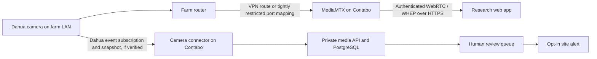

# Direct Dahua camera connection review

**Study:** Human–monkey crop-raiding, Pokhara Metropolitan City, Ward 21

**Target server:** Contabo VPS `169.58.25.131`
**Camera named in the brief:** Dahua DH-P3I-PV / DH-P31-PV (confirm the product label and firmware)

## Decision

A direct camera-to-VPS connection can avoid a farm gateway and a paid cloud service when the farm router exposes a reachable, secure route to the camera. The camera model page lists an RJ-45 network port, 2.4 GHz Wi-Fi, microSD storage, human/vehicle detection, a built-in mic/speaker, and sound/light deterrence. It does not establish that a particular firmware exposes the CGI commands or RTSP path in the brief, and human/vehicle detection does not detect monkeys. Confirm the exact device and firmware before implementation. [Dahua P3I-PV specifications](https://www.dahuasecurity.com/products/wireless-products/outdoor-camera/picoo-series/p3i-pv)

The application now has an optional per-camera stream connector: administrators/technicians enter each camera's independent network route, the VPS tests it, the server stores credentials encrypted, and MediaMTX relays the stream to authorized site users through WebRTC/WHEP. This does not configure farm routers, bypass CGNAT, subscribe to camera events, upload event snapshots, detect monkeys, or execute camera response commands. The right half of the diagram is a future evidence workflow, not a current feature.

## Network decision tree

1. Ask the farm ISP/router administrator whether the WAN address is public and routable. Compare the router WAN address with the address reported by an external IP check. Private or `100.64.0.0/10` WAN ranges commonly indicate upstream NAT/CGNAT; ask the ISP to confirm.
2. If the site router can host WireGuard or another maintained VPN, connect the Contabo VPS to that VPN and route only to the camera's reserved LAN IP and required ports. This avoids exposing camera services directly.
3. If VPN is not available but there is a public routable WAN address, the router can use a DDNS hostname and port mapping. Restrict the inbound source to `169.58.25.131` where the router permits it; forward only the exact tested service ports; use a dedicated read-only camera account and encrypted service where supported. Do not expose the camera's web admin or CGI interface to the whole internet.
4. If the site is behind CGNAT and the router cannot establish an outbound VPN/tunnel, a VPS-initiated connection cannot reach it. DDNS only maps a name to an address; it does not create inbound reachability. Dahua `eventManager.cgi?action=attach` is a persistent HTTP subscription initiated by the server toward the camera, not a camera-originated outbound push, so it does not bypass CGNAT.
5. If no secure route exists and no additional site hardware is allowed, defer CCTV. Use the camera's microSD/DMSS manually as a temporary evidence path while continuing mobile capture.

The `bikasheng.com.np` A record points to the Contabo VPS. It does not point to the farm router. A camera DDNS name must track the farm's public WAN address; configure that separately and never put a camera password in the DNS record or a browser URL.

## Video path

- Verify the camera's RTSP service, stream path, codec, port, authentication, and RTSP-over-TLS support on the exact firmware. The sample `/cam/realmonitor?channel=1&subtype=0` path in the supplied brief is a test candidate, not a confirmed URL for this unit.
- Use the Camera setup flow to test a reachable RTSP/RTSPS or HLS stream and create its MediaMTX path. A separate encrypted database column stores the camera password; only the media relay receives the reconstructed source URL. Logs and browser payloads must not contain that URL or password.
- Serve browser playback with MediaMTX WebRTC/WHEP through HTTPS and an application authorization callback. The documented WHEP endpoint is `/<path>/whep`, not `/<path>/webrtc`. The server issues a short-lived viewer token and checks current user role/site access; the media service is not open to anonymous readers. [MediaMTX WebRTC/WHEP reader docs](https://mediamtx.org/docs/read/webrtc) · [MediaMTX authentication docs](https://mediamtx.org/docs/features/authentication)
- WebRTC uses the HTTPS `/media/` signaling proxy and UDP port 8189 for media. Confirm DNS A/AAAA, firewall, Caddy routing, ICE candidates, and browser codec support on phones before field use. Do not promise sub-500 ms latency until measured on the farm uplink; network latency and Wi-Fi congestion affect the result. [MediaMTX WebRTC network settings](https://mediamtx.org/docs/features/webrtc-specific-features) · [MediaMTX subfolder proxy settings](https://mediamtx.org/docs/features/expose-the-server-in-a-subfolder)
- Keep live view optional. For image research, a verified event snapshot or a short event clip is cheaper to store and easier to review.

## Event and image path

1. Keep a server-side Dahua event subscription only after confirming the firmware returns the event codes and multipart boundary format expected by the parser. Use a reconnecting client with bounded timeouts, heartbeat handling, backoff, and health status.
2. Treat camera-side human/vehicle/motion events as generic triggers. They do not identify monkeys. For monkey detection, run a versioned vision model on sampled frames or saved snapshots, store its confidence and model version, and send uncertain detections to human review.
3. On a trigger, request the camera snapshot only if the model supports the verified snapshot CGI call. Validate JPEG type, size, timestamp, camera ID, and checksum before storing it through the application's existing private-media path.
4. Record event ID, camera/site/plot, UTC time, source event code, media checksum, model suggestion, review state, and camera connectivity/effort. Preserve the original evidence; do not overwrite it with a resized or annotated image.
5. Only create a resident alert after applying the site's notification policy. Label AI-originated alerts as unverified, use site/plot subscriptions and cooldowns, and avoid sharing exact farm coordinates broadly. The existing review-confirmed notification flow is the pilot default.

The claimed event and CGI calls in the pasted brief (`eventManager.cgi`, `snapshot.cgi`, `ptz.cgi`, `coaxialControlIO.cgi`, and `configManager.cgi`) need verification against the exact firmware and a controlled local network. The Dahua product page confirms two-way talk and sound/light deterrence as product features, but that is not confirmation of those CGI command names or parameter behavior for this model.

## Controls and safety boundary

- Add camera controls only after confirming the endpoint behavior and enforcing administrator/technician permissions, CSRF protection, strict parameter allowlists, audit records, command timeouts, and a visible camera identity.
- PTZ should use press-and-hold with stop on release, browser blur, disconnect, and a short server-side maximum duration. Require a deliberate confirmation for presets or movement that can change coverage.
- Keep camera speaker/light actions human-triggered, rate-limited, and logged. Evaluate animal welfare, neighbor impact, and study protocol before using deterrence.
- Do not add high-voltage switching, electrical deterrents, relays, or automatic physical deterrent rules. The pilot has no actuator API.
- Disable camera audio for the image-only pilot unless the research protocol, consent, local requirements, and access policy explicitly approve it.

## Implementation gates

| Gate | Evidence required | Result |
|---|---|---|
| Device identity | Label, region suffix, firmware version, reset/admin access owner | Record before connector work |
| Network | WAN address type, router VPN support, firewall rules, farm uplink test | Select VPN, restricted forward, or defer |
| Local stream | VLC/FFmpeg read test, confirmed URL/codec/auth/TLS, audio disabled | Keep sanitized test notes; never commit credentials |
| Event/snapshot | Captured event samples and JPEG responses from the unit | Implement parser only for observed messages |
| VPS path | Secure connection from Contabo and MediaMTX WHEP playback from a phone | Record latency and reconnect behavior |
| Research workflow | Snapshot enters private media, review queue, audit log, and site-scoped alert | Pilot acceptance |
| Controls | Firmware-tested commands, role policy, timeout behavior, field safety approval | Keep disabled until all gates pass |

## References

- [Dahua P3I-PV product specifications](https://www.dahuasecurity.com/products/wireless-products/outdoor-camera/picoo-series/p3i-pv)
- [Dahua outdoor pan/tilt Wi-Fi camera user manual (PDF)](https://materialfile.dahuasecurity.com/uploads/cpq/83454/user_manual/Wi-Fi_Network_Camera_%28Outdoor_Pan-Tilt%29_User_Manual_V1.0.0.pdf)
- [MediaMTX WebRTC/WHEP reader docs](https://mediamtx.org/docs/read/webrtc)
- [MediaMTX authentication docs](https://mediamtx.org/docs/features/authentication)
