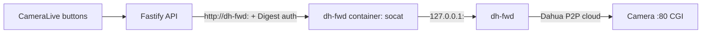

# Remote camera control through dh-fwd (P2P)

Scope: **control only** (PTZ, and optionally manual light/siren). Live video keeps using RTMP publishing and event snapshots keep using the Alarm Center webhook (see `SERVER_CAMERA_SETUP.md`). The tunnel forwards the camera's HTTP port 80 only.

## Why a sidecar container, not a host systemd service

`dh-fwd` binds `127.0.0.1` only. A host systemd service would be invisible to the API container (its own loopback). The `dh-fwd` compose service runs the tunnel and a `socat` bridge on the private `camera_control` network, publishes no host ports, and joins a separate outbound-only `p2p_egress` network. It restarts automatically (`restart: unless-stopped`).

## Risks to accept knowingly

- `dh-fwd` is an **unofficial, reverse-engineered** client of Dahua's cloud. It uses app credentials extracted from the DMSS/SmartPSS apps. It may stop working at any time and may conflict with Dahua's terms. The image is built from a pinned commit; review the source before changing the pin.
- Camera CGI traffic (including Digest credentials) crosses Dahua's relay servers over plain HTTP. Use a dedicated low-privilege camera account.
- Relay latency can delay a PTZ **stop** command. The server sends a stop 850 ms after every start, but the camera may keep moving until that command arrives.
- Siren/light: `AGENTS.md` excludes them from the pilot. They are blocked server-side unless `CAMERA_P2P_DETERRENCE_ENABLED=true`. Change the protocol and `AGENTS.md` first.

## Setup on the VPS

1. Register the camera in DMSS (or SmartPSS) and make sure P2P is on. Note the serial number and which app you used (`dmss` or `smartpss`).
2. Create `secrets/p2p-cameras.conf` from `infra/dh-fwd/p2p-cameras.conf.example`:
   `serial|device_user|device_password|tunnel_port|bridge_port|profile`
   Then `sudo chown 10001:10001 secrets/p2p-cameras.conf && chmod 400 secrets/p2p-cameras.conf`.
3. In `.env`: `CAMERA_P2P_PORT_RANGE=15080-15099` (bridge ports must be inside it).
4. `docker compose config -q`, then `docker compose --profile p2p up -d --build dh-fwd api`.
5. Check `docker compose logs --tail=50 dh-fwd`.
6. In the app, open the camera's Live page, expand **Remote control tunnel (P2P)**, enter the bridge port, the camera's CGI account and password, save, then **Test connection**. The test runs a read-only `magicBox.cgi?action=getDeviceType`.
7. Verify PTZ with a short press while watching the live stream.

## API

| Method | Path | Notes |
|---|---|---|
| GET/PUT/DELETE | `/api/cameras/:id/control-tunnel` | admin/technician; password stored AES-256-GCM, never returned |
| POST | `/api/cameras/:id/control-tunnel/test` | read-only identity query |
| POST | `/api/cameras/:id/control/ptz`, `/control/deterrence` | existing routes, now also accept the tunnel profile |

The API host is the fixed `CAMERA_P2P_BRIDGE_HOST` service name and the port must be inside `CAMERA_P2P_PORT_RANGE`, so a camera record cannot redirect requests to other internal services.

## Not verified yet

The CGI command names (`ptz.cgi`, `coaxialControlIO.cgi`, `configManager.cgi` Lighting) are unconfirmed for the exact camera firmware. `dh-fwd` itself was not built or run against a real camera in CI. Complete the gates in `CAMERA_DIRECT_CONNECTION.md` before field use.
