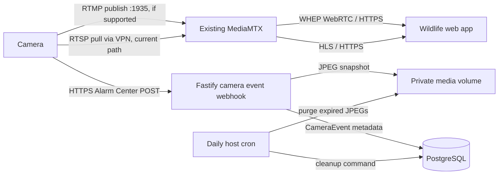

# Server camera setup

This repository already runs one MediaMTX service beside the Fastify API, PostgreSQL, and Caddy. This setup extends that service. It does not add a second media server or enable continuous recording.

## Data flow



MediaMTX listens for RTMP on TCP 1935 and serves HLS internally on 8888. Caddy proxies HLS through HTTPS at `/hls/*`; it proxies the existing WHEP service through `/media/*`. The MediaMTX control API, PostgreSQL, and HLS listener are not published as host ports. Only `pathDefaults.record: false` is configured; HLS uses short-lived RAM segments and does not write video recordings. The authenticated view-token API returns both WHEP and HLS paths; HLS clients must send the returned token in `Authorization: Bearer` on playlist and segment requests.

The current camera has a verified RTSP stream, but its ability to publish RTMP directly has not been verified. The RTMP path below is ready for a camera that supports outbound RTMP. If this Dahua firmware lacks that setting, keep using the existing RTSP/VPN route until a site-side publisher or VPN path is available.

## Camera publishing credentials

An administrator can create or rotate a camera's RTMP publishing credential:

```http
POST /api/cameras/{cameraId}/rtmp-credentials
```

The API returns a path, username, one-time password, and RTMP publish URL. It stores only a SHA-256 hash of the random password. Keep the returned URL out of logs, tickets, and source control. Rotating the credential invalidates the previous password.

The callback validates that the RTMP publisher's username, password, and path match an active camera record. MediaMTX then makes the same path readable via WHEP and HLS. The camera must be able to encode a MediaMTX-compatible H.264/AAC stream. Standard RTMP on port 1935 is not encrypted; use a trusted VPN or RTMPS if the camera supports it.

## Dahua Alarm Center webhook

Create or rotate a per-camera webhook credential as an administrator:

```http
POST /api/cameras/{cameraId}/events/webhook-credentials
```

Configure the camera to POST to `https://bikasheng.com.np/api/v1/camera/events` using HTTP Basic authentication. Use the returned camera UUID as the username and the one-time password as the password. Do not put credentials in the URL. The endpoint accepts one JPEG file in multipart form plus event fields, or JSON with `event_type`, `timestamp`, and `snapshot_base64`. HTTP Basic authentication supplies the camera UUID, so the event body does not choose which camera it belongs to. It validates the JPEG, saves it to private media storage, and creates a `CameraEvent` with `pending_review` status. It never classifies the event as a monkey or triggers an actuator.

The camera must be able to reach the public HTTPS endpoint. If its Alarm Center cannot configure HTTP Basic authentication, the existing VPN-routed Dahua event listener remains available; do not expose the camera's control/web ports to the internet.

## Retention job

The cleanup command removes `CameraEvent` records older than `CAMERA_SNAPSHOT_RETENTION_DAYS` (default 30) and their private JPEG files. It leaves any media asset referenced by another record intact.

Run once manually from the deployment directory:

```sh
docker compose exec -T api npm run cleanup:camera-events
```

Install a daily cron entry on the VPS. If the host timezone is Asia/Kathmandu, run at 02:15:

```cron
15 2 * * * cd /opt/nepal-wildlife && docker compose exec -T api npm run cleanup:camera-events >> /var/log/nepal-wildlife-camera-cleanup.log 2>&1
```

Replace `/opt/nepal-wildlife` with the directory that contains the active Compose file. Install this only after checking that the live app container uses this repository and compose project.

## Deployment checks

The repository Compose configuration publishes TCP 1935 for RTMP and TCP/UDP 8189 for WebRTC. It keeps HLS on the internal Docker network and proxies it through HTTPS. Before applying these changes on the VPS:

1. Inspect `docker compose ps`, the current Compose file, container port bindings, and the Caddy routes. Reuse the existing MediaMTX instance; do not start a second container.
2. Confirm no other host container owns TCP 1935. The earlier `farmcam-direct-mediamtx-1` container may be this same deployment or a separate stack.
3. Validate the effective MediaMTX config and confirm RTMP/HLS listeners start while recording remains disabled.
4. Publish a test stream using a temporary camera credential; confirm the same path is online and readable over WHEP/HLS.
5. Send a test multipart webhook event, confirm a private JPEG and `CameraEvent` row are created, then run cleanup against an isolated expired test event.
6. Add the daily cron entry only after confirming the active deployment directory and database/media volume.

No VPS restart or network change is performed by local repository setup.
